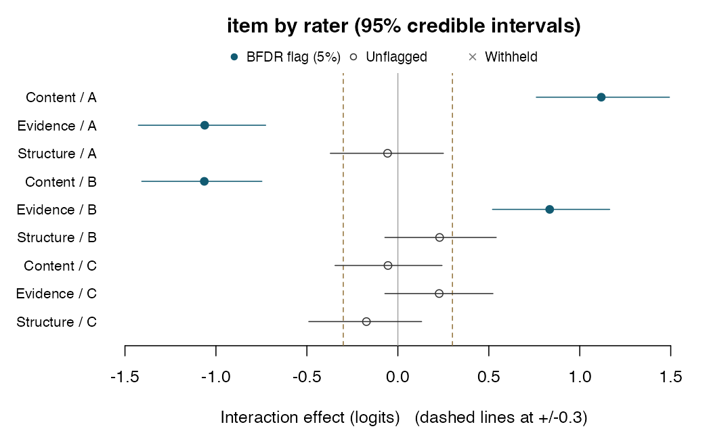
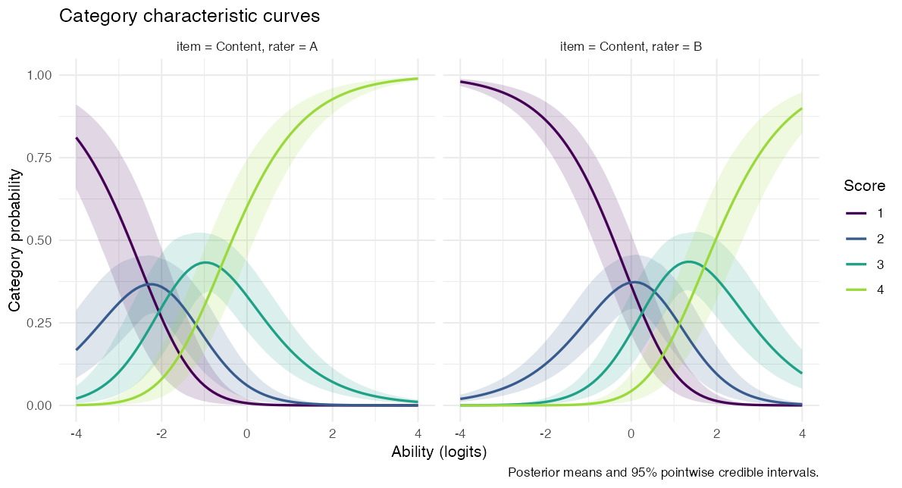

# BayesMFRM

<!-- badges: start -->
[](https://lifecycle.r-lib.org/articles/stages.html#experimental)
<!-- badges: end -->

**BayesMFRM** (v0.1.0.9008, experimental) is an R package for Bayesian Many-Facet Rasch Models (MFRM) using Stan (`cmdstanr`). It supports Rating Scale Models (RSM), uniform and heterogeneous-category Partial Credit Models (PCM), role-agnostic multi-facet formulas, hierarchical partial pooling, two-way interaction (bias) analysis with Student-t and regularized horseshoe shrinkage, structural design-identifiability checks, Sinharay (2006) posterior predictive fit calibration, unified posterior prediction, and target-aware model comparison (PSIS-LOO and K-fold CV).

> Read the complete step-by-step tutorial (with real precomputed output blocks, diagnostic triage, sensitivity analysis, and manuscript reporting templates):
> ```r
> vignette("getting-started", package = "BayesMFRM")
> ```
> Version history and breaking changes are documented in [NEWS.md](NEWS.md).

---

## Installation

BayesMFRM requires [CmdStan](https://mc-stan.org/cmdstanr/) and a C++ toolchain.

```r
# 1. Install cmdstanr and CmdStan (once)
install.packages("cmdstanr", repos = c("https://mc-stan.org/r-packages/", getOption("repos")))
cmdstanr::install_cmdstan()

# 2. Install BayesMFRM (build_vignettes = TRUE to install the tutorial vignette)
remotes::install_github("egumasa/BayesMFRM", build_vignettes = TRUE)
```

---

## Read a fitted example

The bundled simulated writing assessment includes 216 ratings and posterior
summaries from four CmdStan chains. Display the intervals directly in R:

```r
library(BayesMFRM)
data(bmfrm_example)
plot_bias(bmfrm_example$bias)
```



The dashed lines mark the practical threshold of 0.3 logits. Filled points
identify the four cells selected at a Bayesian false discovery rate of 5%.
Use `?bmfrm` to fit these data and `?fair_scores` to plot adjusted scores.

### How do ratings change with ability and rater?

In the same simulated assessment, a writer at ability zero has a **60.2%**
posterior mean chance of receiving a 4 on Content from A (95% credible
interval 45.0–74.6%). With B the chance is **4.3%** (1.3–9.8%).
Read each probability at the same horizontal position in the two panels.



```r
source(system.file("examples", "fit-writing.R", package = "BayesMFRM"))
profiles <- data.frame(item = "Content", rater = c("A", "B"))
plot_category_curves(fit, profiles)
p <- category_curves(fit, profiles, theta = 0)
p[p$category == 4, c("facet_rater", "probability", "lower", "upper")]
```

To compare A and B directly, use `category_contrast(fit, profiles, theta = 0)`.
For a 4 on Content, the posterior mean difference is **55.9 percentage points**
(95% credible interval 39.2–71.0). The interval comes from subtracting B's
probability from A's in each draw. To examine practical similarity, supply a
margin in percentage points, for example `margin_pp = 5`. Each row then gives
the probability that the absolute difference lies within that margin for the
specified score and ability. [View the contrast across abilities](man/figures/writing-category-contrast.png).

- **Where are the rubric steps relative to the writers?** The ridgeline Wright
  map places writer posterior means and the distributions of adjacent-category
  thresholds on one logit scale. [View the Wright map](man/figures/writing-wright-map.png).
- **Is a severe rater also unpredictable?** The Pathway map puts rater
  severity on the vertical axis and infit or outfit on the horizontal axis.
  Compare each point with that rater's replicated fit range.
  [View the Pathway map](man/figures/writing-pathway-map.png).

Each plot is a ggplot2 object. Use `category_thresholds()` for a table of
crossings, including item-specific rubrics. The getting-started vignette shows
how to pass these thresholds to WrightMap.

### How much does an additional rating contribute?

Each row of a plan represents one rating of the same examinee. Compare two
raters scoring two criteria with one rater scoring those same criteria:

```r
plan <- expand.grid(item = c("Content", "Evidence"), rater = c("A", "B"))
one  <- test_information(fit, subset(plan, rater == "A"), theta = -2:2)
both <- test_information(fit, plan, theta = -2:2)
data.frame(theta = both$theta, two_ratings = one$information, four_ratings = both$information)
```

The curves describe conditional Fisher information under local independence.
The credible limits summarize uncertainty in the fitted calibrations. To
compare staffing choices at fixed scoring effort, supply plans with equal
numbers of ratings per examinee.

### Use the fitted model with other R packages

| Question | R interface |
| --- | --- |
| How does rater severity vary across posterior draws? | `posterior::as_draws(fit, variables = "rater")` retains the chains and iterations. Use `tidybayes::spread_draws(fit, rater[r])` for one row per draw and rater. |
| How sensitive are the conclusions to interaction shrinkage? | The optional **priorsense** example scales the interaction prior and rating likelihood separately. It reports changes in bias, rater severity and information, with Pareto diagnostics. [View the sensitivity curves](man/figures/writing-power-sensitivity.png). |
| Where is this particular rating plan informative? | `as_mirt(fit, plan, draw = 1L)` gives an optional **mirt** item bank. Use `mirt::testinfo()` for the plan or `mirt::probtrace()` on an individual rating. |
| Does the model reproduce the ratings or predict held-out ratings? | `bayesplot::pp_check(fit)` draws replicated ratings. `loo::loo(fit)` estimates leave-one-rating-out predictive accuracy. |
| How can I customize the maps? | The native figures return **ggplot2** objects. The vignette shows how to supply person measures and adjacent thresholds to **WrightMap**. |

The mirt bank preserves the selected draw's logit scale, including the rater,
criterion and their fitted interaction. Each row of `plan` becomes one item.
For a posterior mean and credible interval over calibrations, use
`test_information(fit, plan)`. See `?as_mirt` for a runnable example.

To reproduce the power-scaling analysis, run
`source(system.file("examples", "powerscale-writing.R", package = "BayesMFRM"))`
after loading BayesMFRM and installing priorsense. Section 7 of the vignette
also shows how to refit the same ratings using a different prior.

## Quick Start (Self-Contained & Runnable)

Always pass `K` explicitly as the **intended rubric maximum** (e.g., `K = 6` for a 1–6 scale), not just the highest score observed in a sample. By default, `bmfrm()` partially pools examinee abilities (`hierarchical = person_facet`), uses compact streaming outputs (`save_gq = "minimal"`), and caches temporary Stan files in `tempdir()` (pass `cache_dir = tools::R_user_dir("BayesMFRM", "cache")` for persistent cross-session caching).

```r
library(BayesMFRM)

# 1. Create a bridged rating plan (24 examinees x 4 items x 4 raters, 8 ratings/person)
set.seed(42)
full_grid <- expand.grid(
  person = sprintf("P%02d", 1:24),
  item   = sprintf("I%02d", 1:4),
  rater  = sprintf("R%02d", 1:4),
  stringsAsFactors = FALSE
)
plan <- do.call(rbind, lapply(split(full_grid, full_grid$person), function(df) {
  df[sample(nrow(df), 8L), , drop = FALSE]
}))
rownames(plan) <- NULL

# 2. Check structural design identifiability BEFORE fitting
design <- check_design_bmfrm(score ~ person + item + rater, plan, K = 6)
print(design)

# 3. Prior predictive check: verify priors imply plausible category proportions (1..6)
priors_rsm <- c(
  prior("normal(0, 0.5)", "mean", facet = "person"),
  prior("lognormal(-0.5, 0.3)", "sd", facet = "person"),
  prior("normal(0, 0.5)", "facet", facet = "item", scale = "marginal"),
  prior("normal(0, 0.5)", "facet", facet = "rater", scale = "marginal"),
  prior("normal(0, 1.2)", "tau", scale = "marginal")
)
ppc_prior <- prior_predict_bmfrm(
  score ~ person + item + rater, design = plan, K = 6,
  priors = priors_rsm, ndraws = 100, seed = 43
)
round(prop.table(table(ppc_prior$y_rep)), 3)

# 4. Generate a sample dataset (replace with your own data.frame in real studies)
sim <- simulate_bmfrm(
  score ~ person + item + rater, design = plan, K = 6,
  priors = priors_rsm, seed = 44
)
ratings <- sim$data
check_data_suitability(ratings, "score", c("person", "item", "rater"))

# 5. Fit the model (person ability is hierarchical by default; save_gq = "minimal" by default)
fit <- bmfrm(
  score ~ person + item + rater,
  data = ratings,
  K = 6,
  family = "rsm",
  priors = priors_rsm,
  design_check = "error",
  chains = 4,
  iter = 2000,
  seed = 45
)

# 6. Inspect in priority order: (1) Design & MCMC -> (2) Calibrated fit -> (3) Substantive outputs
print(fit)
summary(fit)
bayesplot::pp_check(fit, group = "rater")          # Conditional posterior predictive check
rater_fit <- facet_fit(fit, "rater")               # Calibrated Sinharay (2006) infit_ppp / outfit_ppp
fair_std  <- fair_scores(fit, standardize = TRUE)  # Common-item standardized fair scores
```

> **Custom column names (`person_facet`, `adjust_facets`)**: Your dataset does **not** need columns named `person`, `item`, or `rater`. For example, pass `rating ~ student + task + judge`, `person_facet = "student"`, `adjust_facets = "judge"`, and `prior("normal(0, 1)", "facet", facet = "judge")`.

---

## Choosing Model Options (Why & When)

| Option | Choices & Default | When to use & what it assumes |
| --- | --- | --- |
| `K` | Scalar integer `>= 2` or named vector (PCM) | **Always specify explicitly.** Omitting `K` infers `max(score)` from the sample (with a message), dropping unobserved upper rubric categories. |
| `family` | `"rsm"` (default) vs `"pcm"` | `"rsm"` shares one step profile across levels; `"pcm"` (`threshold_facet = "item"`) allows level-specific step widths (including heterogeneous `K`). With equal category counts, add `"tau"` to `hierarchical` for partial pooling toward `tau_common`. |
| `person_facet` & `adjust_facets` | `"person"` (default); `NULL` (auto `"rater"`/`"interlocutor"`) | Explicitly declares which column represents examinee ability and which nuisance facets are zeroed in `fair_scores()`. |
| `hierarchical` | `person_facet` (default) vs `character(0)` or `c("person", "rater", "item:rater", "tau")` | Default `person_facet` partially pools examinees (including uncertainty in the population mean and SD). Add centered facets or interactions when sufficient levels exist to estimate their SD; with very few raters ($R \le 5$), compare against fixed marginal priors (`adapt_delta >= 0.98`). |
| `scale` in `prior()` | `"raw"` (default) vs `"marginal"` | Under sum-to-zero constraints on $J$ levels, `"raw"` specifies the pre-centering SD (marginal SD is $\sigma\sqrt{1 - 1/J}$). `"marginal"` keeps the post-centering SD equal to $\sigma$ regardless of $J$. Default `tau` prior is `normal(0, 2)` so wide rubrics ($\pm 3$ logits) are not compressed. |
| `local_shrinkage` | `"none"` (default), `"student_t"`, `"horseshoe"` | For hierarchical 2-way interactions. `"student_t"` (`scale = "marginal"`) provides heavier tails at matched cell SD; `"horseshoe"` (`scale = "raw"`, configurable `slab_df` and `slab_scale`) concentrates mass near zero. Note: latent local shrinkage precedes double centering $B = P_1 U P_2$, redistributing small centering offsets across rows/columns. |
| `flag_method` & `delta` in `summarise_bias()` | `flag_method = "bfdr"` (default, `fdr_thresh = 0.05`), `delta = 0` | Controls multiplicity via tie-invariant Bayesian FDR over observed, likelihood-identified cells (`n_observations == 0` cells are marked `"unobserved_cell"` and excluded). Combine with a practical threshold `delta > 0` (e.g., `0.25`–`0.30` logits) and configurable `ci_level`. |
| `save_gq` & `cache_dir` | `"minimal"` (default); `tempdir()` (default) | Streams quantities in R without bloating CSVs or writing into the working directory. Pass `cache_dir = tools::R_user_dir("BayesMFRM", "cache")` with an explicit `seed` to reuse fits across sessions. |

---

## Key Methodological Notes

1. **Why `facet_fit()` reports Posterior Predictive $p$-values (`infit_ppp`, `outfit_ppp`) as primary**:
   Averaging realized discrepancies $(y_n - \mu_n^{(d)})^2 / \sigma_n^{2(d)}$ over posterior draws inflates MSQ above `1.0` whenever posterior parameter uncertainty is non-negligible (especially for sparse examinees with $n_{\text{obs}} = 2\text{–}4$), causing asymptotic Wilson–Hilferty `|ZSTD| > 2` rules to emit false alarms. Following Sinharay (2006), `facet_fit()` compares $\text{MSQ}(y, \psi^{(d)})$ against replicated $\text{MSQ}(y_{\text{rep}}^{(d)}, \psi^{(d)})$ on the **same posterior draws** (`PPP` near `0` indicates erratic underfit; `PPP` near `1` indicates muted overfit; pass `include_zstd = TRUE` only for descriptive comparison).
2. **FACETS "Fair Average" vs. `fair_scores()`**:
   - **FACETS Fair Average** evaluates $E[Y \mid \theta_p, \text{item} = 0, \text{rater} = 0]$ at a single hypothetical origin item.
   - **`fair_scores(fit, standardize = FALSE)`** averages expected scores over each examinee's *observed* items (setting `adjust_facets = 0`).
   - **`fair_scores(fit, standardize = TRUE)`** averages expected scores across the *full common reference grid* of items (`reference_grid`, optionally weighted by `reference_weights`). By Jensen's inequality on the nonlinear category expectation, averaging over real item difficulties differs slightly from evaluating a single item at `0`.
3. **Bayesian Shrinkage Trade-Off in Rater Bias Detection**:
   Relative to Marginal ML + EAP (e.g., ACER ConQuest), hierarchical Bayes achieves virtually identical examinee ability RMSE on standard designs while propagating full parameter uncertainty into intervals and fair-score contrasts. In sparse interaction (`item:rater`) estimation, shrinkage priors substantially reduce **overall and null-cell RMSE** (suppressing false alarms on low-count cells) at the cost of **attenuating truly active biased cells toward zero**. Use heavy-tailed shrinkage (`"student_t"` or `"horseshoe"`), practical `delta` thresholds, and sensitivity checks when screening for active rater bias.

---

## Documentation, Validation, & Benchmarks

- **Introductory vignette (English, with verified precomputed outputs)**: `vignette("getting-started", package = "BayesMFRM")` ([vignettes/getting-started.Rmd](vignettes/getting-started.Rmd))
- **Target-aware model comparison guide (`sirt::data.ratings1`, PSIS-LOO + 5-fold person CV)**: [docs/model-comparison-ratings1.md](docs/model-comparison-ratings1.md) / [docs/compare-ratings1-cv.R](docs/compare-ratings1-cv.R)
- **Interactive offline HTML report**: [docs/index.html](docs/index.html) / [docs/reproduce-ratings1.R](docs/reproduce-ratings1.R)
- **Simulation-Based Calibration (SBC) & Empirical Benchmarks**:
  - `Rscript --vanilla simulations/sbc_calibration.R` (SBC rank/ECDF calibration across Hierarchical RSM, Hierarchical PCM, Student-t, and Horseshoe interactions)
  - `Rscript --vanilla simulations/bayesian_benefits.R` (Joint ML vs. Gauss-Hermite MML-EAP vs. BayesMFRM + null-vs-active bias shrinkage trade-off)
  - `Rscript --vanilla simulations/conquest_comparison.R` (Cross-software validation against ACER ConQuest 5.47.5)
- **Developer & architecture notes**: [README.dev.md](README.dev.md) | **Changelog**: [NEWS.md](NEWS.md)

## License

Licensed under [CC BY-NC-SA 4.0](https://creativecommons.org/licenses/by-nc-sa/4.0/).
